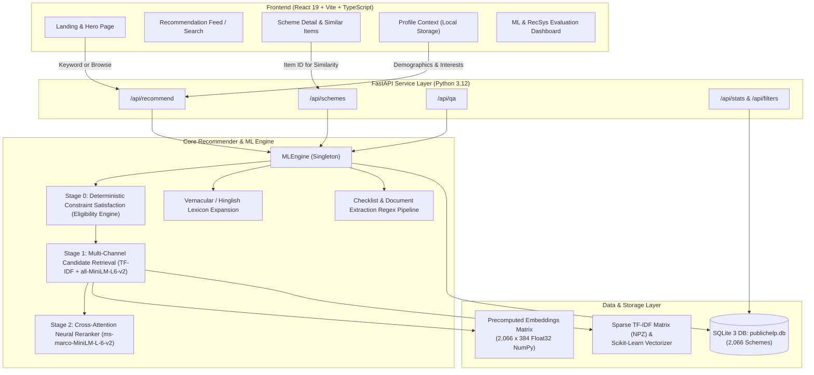
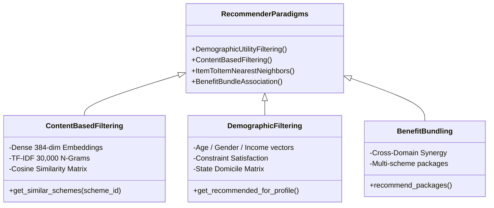

# Technical Documentation: PublicHelp AI — Government Scheme & Benefit Recommender

> **Academic Project Reference & Architecture Specification**  
> **Domain:** Machine Learning & Recommender Systems / Civic Technology  
> **Dataset:** 2,066 Authentic Indian Government Schemes (`gov-myscheme-dataset`)  
> **Execution Environment:** Local, offline-capable, CPU/GPU compatible, zero external paid API dependencies.

---

## 1. Executive Summary & Problem Formulation

### 1.1 The Civic Information Gap in India
India operates one of the world's most extensive social welfare systems, comprising over **2,000 active central and state schemes** covering agriculture, maternal health, secondary and higher education, housing, micro-finance, and social security pensions. However, an acute **discovery and navigation barrier** persists:

1. **Information Asymmetry & Fragmentation:** Scheme guidelines are scattered across dozens of central ministries and 36 States/UTs, often buried in multi-page government gazette notifications or bureaucratic PDFs.
2. **Cognitive Overload in Search:** Existing portals (such as *myScheme.gov.in*) primarily operate as keyword-search directories. A citizen searching for *"scholarship"* is confronted with hundreds of uncurated results, with no automated assessment of whether their specific caste, age, state, or income matches the scheme's criteria.
3. **The "Cold Start" Citizen Problem:** Most vulnerable beneficiaries (e.g., smallholder farmers, rural artisans, elderly citizens) do not know bureaucratic keywords or official scheme names (*"PMAY"*, *"KCC"*, *"PM-KISAN"*). A pure search engine fails them; what they need is a **Personalized Recommender System** that takes their demographic profile and pushes relevant, eligible opportunities.

### 1.2 Mission of PublicHelp AI
PublicHelp AI addresses this by implementing an **explainable, multi-stage hybrid recommender and retrieval architecture**. It deterministically verifies eligibility constraints, computes dense semantic and demographic affinities, and ranks schemes with transparent, verifiable explanations.

---

## 2. End-to-End System Architecture

The project adheres to a clean decoupled architecture: a high-performance **FastAPI backend** running an in-memory ML engine, backed by an **FTS5-enabled SQLite database**, communicating over JSON REST APIs with a modern **React 19 + TypeScript** client application.



---

## 3. The Data Pipeline & Knowledge Representation

### 3.1 Dataset Provenance & Cleansing
All scheme records originate from the authentic `gov-myscheme-dataset` (scraped directly from `myscheme.gov.in`). The ingestion pipeline (`scripts/ingest_data.py`) ingests, normalizes, parses, and deduplicates 2,066 schemes.

| Attribute | Metric / Value | Technical Rationale |
|---|---|---|
| **Total Schemes** | 2,066 authentic records | Complete public catalog snapshot |
| **Central Schemes** | 527 schemes (25.5%) | Open to all Indian citizens regardless of state domicile |
| **State / UT Schemes** | 1,539 schemes (74.5%) | Domicile-locked to specific States/UTs |
| **Name & Description Coverage** | 100% | Full text available for embedding generation |
| **Benefits Coverage** | 100% | Key value propositions indexed |
| **Official Links Coverage** | 100% | Direct links to government application portals |
| **Structured Age Parsing** | 18.4% (381 schemes) | Extracted via boundary regex from free text |
| **Structured Gender Parsing** | 22.0% (455 schemes) | 367 female-only, 3 male-only, 85 unisex |
| **Income Ceiling Parsing** | 3.8% (79 schemes) | Sparse in raw text; parsed as INR annual ceiling |
| **Caste Category Parsing** | 17.1% (354 schemes) | SC / ST / OBC / EWS / General tags extracted |

### 3.2 Automated Document Tagging Pipeline
Government welfare schemes frequently fail at the point of application because citizens lack required paperwork. The system incorporates an automated regex pipeline to identify and tag 10 standardized Indian civic credentials from unstructured eligibility text:

1. **Aadhaar Card**
2. **Income Certificate** (Tahsildar certificate, BPL ration card)
3. **Caste Certificate** (SC/ST/OBC community certificates)
4. **Domicile / Residence Certificate** (Nativity certificate)
5. **Bank Passbook / Cancelled Cheque**
6. **Ration Card**
7. **Disability Certificate / UDID Card**
8. **Educational Marksheet / College ID / Bonafide**
9. **Land Records / Patta / 7/12 / Khasra**
10. **Passport Photographs**

---

## 4. The Recommendation & Ranking Engine (Deep Dive)

The system rejects the "black-box" model in favor of an **explainable 3-tier hybrid recommender pipeline**:

```
                       [ Incoming Request ]
            (User Profile: Age, Gender, State, Income, Goals)
                               │
                               ▼
┌─────────────────────────────────────────────────────────────┐
│  Tier 1: Deterministic Constraint Satisfaction Engine        │
│  - Evaluates hard constraints (Age, Gender, Income, State)   │
│  - Filters out NOT_ELIGIBLE schemes                         │
│  - Assigns: POTENTIALLY_ELIGIBLE or NEEDS_MORE_INFO         │
└──────────────────────────────┬──────────────────────────────┘
                               │ (Surviving Candidates)
                               ▼
┌─────────────────────────────────────────────────────────────┐
│  Tier 2: Multi-Objective Utility Scoring (Stage 1)           │
│  - Sparse Lexical Similarity (TF-IDF Cosine: 35%)            │
│  - Dense Semantic Embeddings (all-MiniLM-L6-v2: 35%)         │
│  - Demographic Attribute Matching (Profile Fit: 25%)         │
│  - State Domicile Alignment (Central vs State: 20%)          │
│  - Category & Goal Match (10%)                               │
│  - Data Completeness Confidence (10%)                        │
│  - Eligibility Status Multiplier (x1.1 or x0.9)             │
└──────────────────────────────┬──────────────────────────────┘
                               │ (Top 25 Ranked Candidates)
                               ▼
┌─────────────────────────────────────────────────────────────┐
│  Tier 3: Stage 2 Neural Cross-Attention Reranking            │
│  - Model: cross-encoder/ms-marco-MiniLM-L-6-v2              │
│  - Evaluates all-to-all token cross-attention                │
│  - Score Calibration: Sigmoid function                      │
│  - Final Score = 0.45 * Sigmoid(CE) + 0.55 * Score_Stage1    │
└──────────────────────────────┬──────────────────────────────┘
                               │
                               ▼
                    [ Ranked Recommendation Feed ]
```

### 4.1 Tier 1: Deterministic Eligibility Engine (`eligibility.py`)
Unlike e-commerce recommenders where recommending an incompatible item has low risk, recommending a welfare scheme for which a citizen is ineligible wastes time and causes distress. 

The rule engine assesses:
* **Age Rules:** Checks if $\text{parsed\_min\_age} \le \text{user\_age} \le \text{parsed\_max\_age}$.
* **Gender Rules:** If a scheme is designated female-only, male profiles are tagged `NOT_ELIGIBLE`.
* **Income Ceilings:** If $\text{user\_income} > \text{parsed\_income\_max}$, candidate is flagged `NOT_ELIGIBLE`.
* **State Domicile:** Central schemes apply nationally. State schemes require state matching.
* **Caste/Category:** If a scheme requires SC/ST and user profile indicates General, it flags `NOT_ELIGIBLE`.

**Tri-State Outcome Logic:**
* `NOT_ELIGIBLE`: Hard pruned from output feed.
* `POTENTIALLY_ELIGIBLE`: All rules validated positively. Receives a $+10\%$ ranking bonus ($1.1\times$).
* `NEEDS_MORE_INFO`: Critical data fields are unstated in the raw text or the user profile. Retained in feed with a cautionary badge and a $-10\%$ damping factor ($0.9\times$).

### 4.2 Tier 2: Multi-Objective Utility Formulation
For every surviving scheme $i$, Stage 1 computes an explainable utility score $U(i, P, Q)$ parameterized by profile $P$ and optional search intent $Q$:

$$U(i, P, Q) = \left( w_{\text{sem}} S_{\text{sem}} + w_{\text{prof}} S_{\text{prof}} + w_{\text{state}} S_{\text{state}} + w_{\text{cat}} S_{\text{cat}} + w_{\text{comp}} S_{\text{comp}} \right) \times M_{\text{elig}}$$

**Parameter Weights:**
* $w_{\text{sem}} = 0.35$ (Semantic Intent Alignment)
* $w_{\text{prof}} = 0.25$ (Demographic Profile Match)
* $w_{\text{state}} = 0.20$ (State Domicile Relevance)
* $w_{\text{cat}} = 0.10$ (Citizen Goals / Category Overlap)
* $w_{\text{comp}} = 0.10$ (Scheme Data Quality & Completeness)
* $M_{\text{elig}} = 1.10$ if status is `POTENTIALLY_ELIGIBLE`, else $0.90$.

**Component Definitions:**
1. **Semantic Similarity ($S_{\text{sem}}$):**  
   If an explicit query $Q$ exists, it is expanded via the vernacular dictionary (`kisan` $\to$ `farmer agriculture`, `chhatravritti` $\to$ `scholarship student`, `avas` $\to$ `housing`).  
   Dense cosine similarity is computed against precomputed 384-dimensional `all-MiniLM-L6-v2` embeddings:
   $$S_{\text{dense}} = \frac{\mathbf{e}_Q \cdot \mathbf{e}_i}{\|\mathbf{e}_Q\| \|\mathbf{e}_i\|}$$
   Blended with sublinear TF-IDF cosine similarity: $S_{\text{sem}} = 0.60 S_{\text{dense}} + 0.40 S_{\text{tfidf}}$.  
   *(In pure recommendation mode with no query, $S_{\text{sem}}$ is set to a neutral baseline of $0.50$.)*
2. **Profile Match ($S_{\text{prof}}$):**  
   Proportion of age, gender, and income constraints matched:
   $$S_{\text{prof}} = \frac{\text{Hits}}{\text{Evaluated Checks}} \quad (\text{default } 0.50 \text{ if no profile bounds exist})$$
3. **State Relevance ($S_{\text{state}}$):**  
   * $1.0$ if user state matches scheme state ministry.
   * $0.8$ if scheme is a Central Government scheme (universal applicability).
   * $0.1$ if scheme belongs to a different state.
4. **Category Match ($S_{\text{cat}}$):**  
   Jaccard-like overlap between user interest tags (e.g. `['Agriculture', 'Health']`) and scheme categories.

### 4.3 Tier 3: Neural Cross-Attention Reranking
Dense bi-encoder retrieval ($S_{\text{dense}}$) relies on independently mapped vectors, which cannot model intricate token interactions between the user's constraints and the scheme's benefit provisions. 

To overcome this, the top 25 candidates undergo **Stage 2 Cross-Encoder Reranking** using `cross-encoder/ms-marco-MiniLM-L-6-v2`:
1. Concatenated pairs `[Query/Profile, Scheme Title + Benefits Snippet]` are passed into a 6-layer Transformer.
2. Full cross-attention computes token-to-token interactions across the entire pair.
3. The raw logits $s$ are passed through a logistic sigmoid:
   $$\sigma(s) = \frac{1}{1 + e^{-s}}$$
4. The final score is a weighted blend:
   $$\text{Score}_{\text{final}} = 0.45 \cdot \sigma(s) + 0.55 \cdot \text{Score}_{\text{Stage1}}$$

---

## 5. RecSys Paradigms & Algorithms

In the context of Recommendation Systems coursework and academic defense, this system implements key recommender paradigms:



### 5.1 Content-Based Filtering (CBF) & Item-to-Item Similarity
* **Mechanism:** Every scheme is represented by a normalized 384-dimensional dense semantic embedding vector $\mathbf{v}_i \in \mathbb{R}^{384}$.
* **Item-to-Item Similarity:** For any scheme $A$, similar schemes $B$ are computed using dot-product cosine similarity across the precomputed embedding matrix:
  $$\text{sim}(A, B) = \mathbf{v}_A \cdot \mathbf{v}_B$$
* **Application:** Used in the *"Similar & Complementary Schemes"* module on the scheme details page to surface alternatives and related state-level counterparts.

### 5.2 Demographic & Attribute-Based Filtering
* Solves the **User Cold-Start Problem**: When a first-time user visits with zero interaction history, collaborative filtering fails.
* The system constructs an attribute utility matrix mapping the citizen's demographic vector $(\text{Age}, \text{Gender}, \text{Income}, \text{State}, \text{Caste})$ directly to eligible schemes.

### 5.3 Civic Benefit Bundles (Association Mining)
Citizens rarely need only a single scheme. For example:
* An Indian farmer qualifying for **PM-Kisan** (direct income support) almost universally qualifies for the **Kisan Credit Card** (subsidized institutional credit) and the **PM Fasal Bima Yojana** (crop insurance).
* A female college student qualifying for a state merit scholarship also qualifies for subsidized bus transit and digital device schemes.
* Bundling models group schemes by complementary category vectors to recommend **Welfare Packages**.

---

## 6. API Architecture & Data Contracts

All endpoints are hosted via FastAPI under `/api` with OpenAPI / Swagger schema compliance:

| Method | Endpoint | Description | Key Payload / Query Params |
|---|---|---|---|
| `GET` | `/api/health` | Service liveness, ML readiness, and active compute device | None |
| `GET` | `/api/stats` | Dataset distributions, Central vs State counts, hardware stats | None |
| `GET` | `/api/filters` | Dynamic lists of states, categories, and levels | None |
| `GET` | `/api/schemes` | Paginated scheme browsing with query/state filters | `page`, `page_size`, `state`, `level` |
| `GET` | `/api/schemes/{id}` | Complete scheme profile, structured documents & eligibility | Path parameter `id: int` |
| `POST` | `/api/recommend` | Primary hybrid recommendation and ranking endpoint | `RecommendRequest` (profile, filters, query, top_k) |
| `POST` | `/api/qa` | Grounded extractive question answering | `query: str` |
| `POST` | `/api/saved/{session_id}/{scheme_id}` | Bookmark / save scheme for local session | Path parameters `session_id`, `scheme_id` |
| `POST` | `/api/compare` | Multi-scheme side-by-side comparative analysis | `scheme_ids: list[int]`, `profile: UserProfile` |

### 6.1 Recommend Request Data Contract
```json
{
  "query": "",
  "profile": {
    "state": "Maharashtra",
    "age": 20,
    "gender": "female",
    "caste_category": "OBC",
    "annual_income": 180000,
    "education": "College / University",
    "occupation": "Student",
    "goals": ["Education", "Skill Development"]
  },
  "filters": {
    "level": "State / UT Government"
  },
  "top_k": 10,
  "page": 1
}
```

---

## 7. Recommender Systems vs. Information Retrieval: Evaluation Metrics

In academic research, Information Retrieval and Recommender Systems are evaluated on distinct mathematical axes. The project incorporates both:

### 7.1 Information Retrieval Metrics (Grounded on 30 Curated Civic Benchmark Queries)
* **Precision@K ($P@K$):** Fraction of top-$K$ returned schemes that are genuinely relevant.
  $$P@K = \frac{|\text{Relevant Schemes in Top } K|}{K}$$
* **Recall@K ($R@K$):** Fraction of all known relevant schemes discovered within top-$K$.
* **Mean Reciprocal Rank (MRR):** Measures how high the first relevant scheme appears:
  $$\text{MRR} = \frac{1}{|Q|} \sum_{q=1}^{|Q|} \frac{1}{\text{rank}_q}$$
* **Normalized Discounted Cumulative Gain (NDCG@K):** Evaluates ranking quality with logarithmic position discount:
  $$\text{DCG}@K = \sum_{i=1}^K \frac{2^{\text{rel}_i} - 1}{\log_2(i + 1)}, \quad \text{NDCG}@K = \frac{\text{DCG}@K}{\text{IDCG}@K}$$

### 7.2 Recommender System (RecSys) Evaluation Metrics
* **Catalog Coverage:** The percentage of the 2,066 schemes that the recommendation engine is capable of recommending across all user demographic segments (mitigating the "superstar / popularity bias" where only the top 10 famous schemes are ever seen):
  $$\text{Coverage} = \frac{|\bigcup_{u \in U} R(u)|}{|I|}$$
* **Intra-List Diversity (ILD):** Ensures the top-$N$ recommendation list does not contain 10 redundant variations of the same benefit, measuring pairwise distance:
  $$\text{ILD}(R) = \frac{2}{N(N-1)} \sum_{i \in R} \sum_{j \in R, j \neq i} \left(1 - \text{sim}(\mathbf{v}_i, \mathbf{v}_j)\right)$$
* **Novelty & Serendipity:** Penalizes over-recommending popular central schemes, rewarding the surfacing of niche, high-value state-specific initiatives.
* **Personalization Dissimilarity:** Measures the average pairwise distance between recommendation vectors generated for distinct citizen personas:
  $$\text{Personalization} = 1 - \frac{1}{|U|(|U|-1)} \sum_{u_1 \neq u_2} \text{Jaccard}(R(u_1), R(u_2))$$

---

## 8. Privacy, Security & Ethical Safeguards

1. **Client-Side Profile Storage:** All personal demographic inputs (age, income, caste, state) are persisted strictly within the user's browser `localStorage` or React session state. No PII is logged to persistent backend databases.
2. **Deterministic Safety Filter:** In high-stakes public welfare, machine learning hallucinations or probabilistic guesses are unacceptable. If a citizen's profile violates a mandatory ceiling (such as age or income), the deterministic rule engine enforces a **hard exclusion**, overriding any semantic text similarity.
3. **Mandatory Official Provenance:** Every single scheme displayed in the UI links directly to the official government portal (`official_link`) and its canonical `myScheme.gov.in` entry point.
4. **Offline Local Reproducibility:** The entire stack runs without paid third-party APIs (OpenAI, Anthropic, or proprietary cloud engines), ensuring reproducible execution on standard hardware.

---

## 9. Summary: How to Defend This Project in a Viva / Review

When presenting this project to an evaluator, emphasize these four foundational answers:

1. **"Why isn't this just a search engine?"**  
   *Because search requires the user to know what to ask for.* In public welfare, citizens do not know scheme names. PublicHelp AI operates as a **push-based Recommender System**: given a citizen's demographic profile, it computes demographic utility, prunes hard ineligibilities, and recommends personalized benefit bundles without requiring keyword queries.
2. **"What ML models are used?"**  
   A **2-Stage Neural Retrieval and Reranking Architecture**: Stage 1 uses a hybrid bi-encoder (`sentence-transformers/all-MiniLM-L6-v2`) + sparse TF-IDF (30,000 n-grams) for candidate generation, combined with a deterministic constraint satisfaction engine. Stage 2 applies a Transformer Cross-Encoder (`cross-encoder/ms-marco-MiniLM-L-6-v2`) with full cross-attention over top candidates.
3. **"Where is Content-Based Item Recommendation?"**  
   Every scheme in the 2,066 dataset has a normalized 384-dimensional dense semantic embedding. The system computes item-to-item nearest neighbors via cosine similarity, powering the *"Similar & Complementary Schemes"* discovery engine.
4. **"How do you handle Cold Start?"**  
   Through demographic attribute filtering and pre-configured citizen archetype personas that generate dynamic, high-utility recommendations from day zero without requiring prior user interaction history.
